# HustleHub client (React + Vite)

The React frontend for HustleHub. It covers registering, logging in, browsing and searching gigs, booking, viewing bookings and receipts, payments for clients, gig management and income for freelancers, and an admin overview. It talks only to the HustleHub API (`/api`), which enforces every security rule again on the server.

## Features by role

| Role | Pages |
|------|-------|
| Guest | Home (choose hire or earn), Log in, Register |
| Client | **Browse gigs** (search + category) · book with optional notes · **booking receipt** showing the booking and its transaction · **My bookings** · **Payments** (every transaction recorded for their bookings, with a total) |
| Freelancer | **My gigs** (create, edit, hide/show, delete with confirmation) · **Bookings** on their gigs · **Income** (total earned, estimated tax and net, six-month chart, transaction record) · Marketplace view |
| Admin | **Admin** (user and role counts, booking volume, all users, all transactions linking to each booking receipt) · gig moderation from Browse gigs (delete with confirmation) |

### Booking and transaction flow in the UI

1. The client opens a gig card and clicks **Book this gig**, adds optional notes (500 characters max) and clicks **Confirm booking**.
2. The request body is only `{ gigId, notes }`. The price is never sent, because the server reads it from the gig.
3. The API returns the booking **and** the transaction it recorded. The app opens the receipt at `/bookings/:id`. The receipt shows the booking reference (`BK-…`) and the linked transaction (`TXN-…`, simulated, paid).
4. The same transaction then appears under the client's **Payments** and the freelancer's **Income**. Every booking, transaction and admin row links back to the receipt.

## Security measures in the client

The API is the security boundary. The client adds defence in depth and makes sure nothing sensitive reaches the screen.

- **No HTML injection.** All data is rendered as text by React. There is no `dangerouslySetInnerHTML`, and a test checks that `` payloads are rendered as text.
- **Strict CSP compatible.** There are no inline scripts or inline styles: the income chart uses SVG attributes, not `style`. Fonts are bundled with `@fontsource` and served from the same origin, so the production policy (`default-src 'self'`, `script-src 'self'`, `style-src 'self'`, `font-src 'self'`) needs no exceptions. The production build ships **no source maps**.
- **Development CSP.** `vite.config.js` also sends a CSP, `X-Frame-Options: DENY`, `nosniff` and `no-referrer` from the dev server. The dev policy allows `'unsafe-inline'` only because Vite's hot reload needs it. The production build served by Express uses the strict policy.
- **Token handling.** The JWT is kept in `sessionStorage` (cleared when the tab closes) and sent only as a `Bearer` header to the same origin. The app **logs out automatically when the token expires**, and on any `401`, then explains on the login page that the session ended. Passwords are never stored. A rejected password is cleared from the login form.
- **Safe errors.** `api/client.js` shows the API's 4xx messages, which are deliberately generic, and replaces anything from a **5xx response with its own wording**. Stack traces, file paths and database messages can therefore never appear on screen. Network failures show "Unable to reach the server". Field errors from the API are shown next to the matching input.
- **Validation for usability.** Rules mirror the server (name length, email, password strength with live hints, gig title/description/price ranges, notes length). This gives instant feedback but is not a security control: the API validates everything again.
- **Route guards.** `ProtectedRoute` sends guests to log in and redirects users away from pages their role cannot use. Navigation shows only the pages for the user's role. The API still returns 401/403 if a page is forced.
- **Access to other users' data.** If the API refuses a booking (403/404), the receipt page shows "We couldn't find that booking, or it isn't yours to view" and reveals nothing about it.
- **Accessibility.** Labels are linked to inputs, invalid fields have `aria-invalid`, hints and errors are linked with `aria-describedby`, errors use `role="alert"`, and there's a skip link, visible focus styles and a mobile menu.

## Running

From the repository root (backend running on `https://localhost:5443`):

```bash
npm run client:install
npm --prefix client run dev      # http://localhost:5173, proxies /api to the HTTPS backend
```

Production-style (the strict CSP applies):

```bash
npm run client:build             # creates client/dist
npm start                        # open https://localhost:5443
```

## Testing

```bash
npm run test:client              # or, inside client/: npm test / npm run test:watch
```

**11 test files, 46 tests** (Vitest + React Testing Library + user-event):

| File | What it shows |
|------|---------------|
| `LoginPage.test.jsx` | Form renders · empty submit shows errors with no API call · credentials submitted · API error shown |
| `RegisterPage.test.jsx` | Role pre-selected from the link · live password hints · mismatched passwords blocked · role sent, **confirmation never sent** · server field errors shown next to the input · duplicate-account message |
| `GigCard.test.jsx` | Gig rendered · booking interaction · role-appropriate buttons · **XSS payload rendered as text** |
| `GigForm.test.jsx` | Validation blocks bad input · clean payload submitted |
| `BookingFlow.test.jsx` | **Book a gig → receipt shows the booking and the transaction reference** · request body is only `gigId` + `notes` (no price) · rate-limit (429) message · **403 on another user's booking shows nothing** · saved booking matched to its transaction |
| `PaymentsPage.test.jsx` | Client's transactions listed with links to bookings and a total · empty state · **5xx details never shown** |
| `MyGigsPage.test.jsx` | Delete needs confirmation · hide sends only `{ active: false }` · edit form pre-filled |
| `Navbar.test.jsx` | Each role sees only its own pages · guests see Log in / Register |
| `ProtectedRoute.test.jsx` | Guests redirected · wrong role redirected · allowed role sees the page · loading state |
| `apiClient.test.js` | Bearer token attached · 5xx replaced with a generic message · network failure · **401 ends the session** · field errors normalised · JWT expiry read |
| `utils.test.js` | Password rules · admin role rejected · price range · notes cap · receipt references · monthly totals |

Tests mock `fetch` (see `src/tests/helpers.jsx`), so they run without the backend.

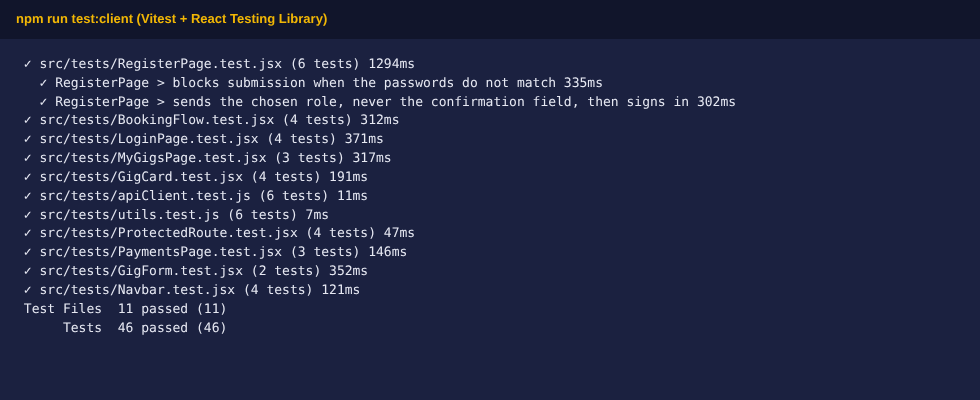

## Structure

```
client/
├── index.html
├── vite.config.js            # dev proxy, dev CSP headers, no source maps, Vitest config
├── public/favicon.svg
├── docs/screenshots/         # evidence screenshots used in this README
└── src/
    ├── main.jsx  App.jsx  styles.css
    ├── api/client.js         # fetch wrapper: JWT, safe errors, 401 handling, token expiry
    ├── context/AuthContext.jsx   # session, auto-logout on expiry, role home pages
    ├── components/           # Navbar, ProtectedRoute, Field, Alert, GigCard, GigForm,
    │                         # BookingReceipt, IncomeChart, StatusBadge, Loading, EmptyState
    ├── pages/                # Home, Login, Register, Gigs, MyGigs, Bookings, BookingDetail,
    │                         # Payments, Income, Admin, NotFound
    ├── utils/                # validation.js (mirrors API rules), format.js
    └── tests/                # Vitest + Testing Library (+ helpers.jsx)
```

## Screenshots

| | |
|---|---|
| Home 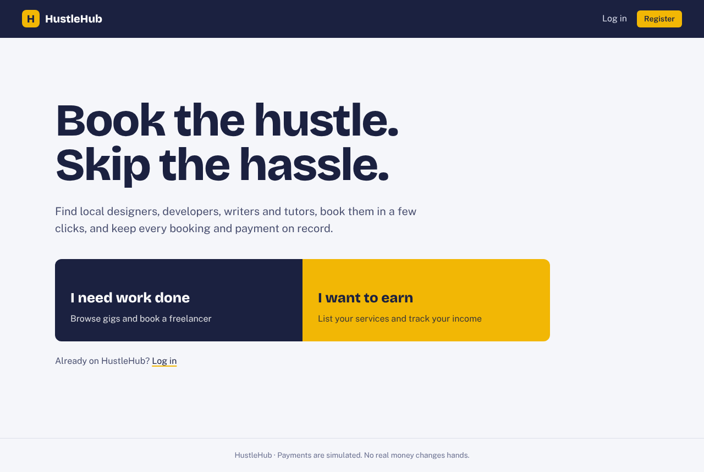 | Register validation 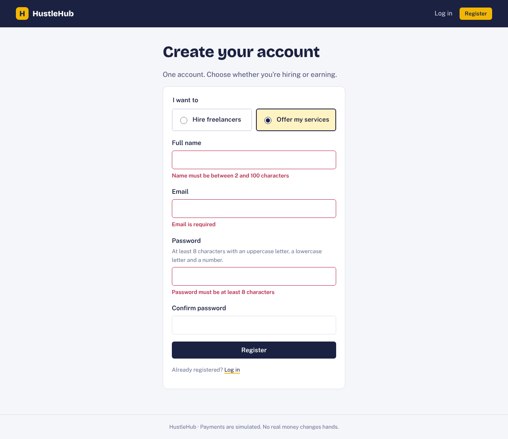 |
| Login error (generic) 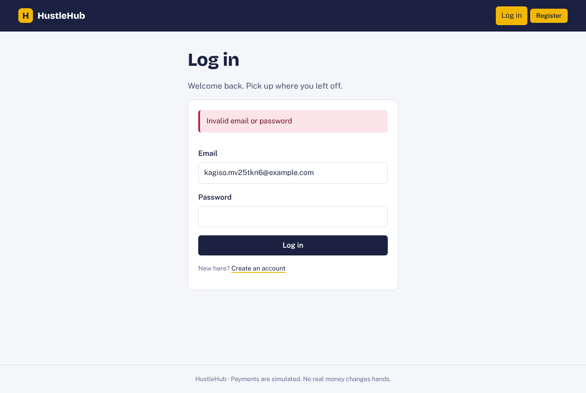 | Gig form validation 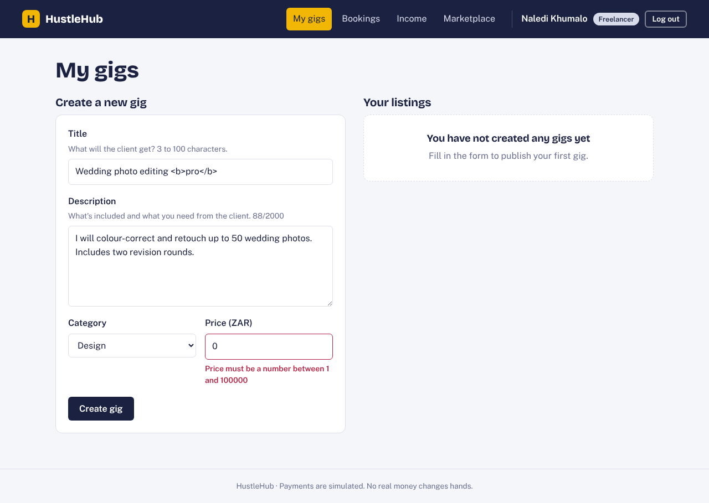 |
| Freelancer: my gigs 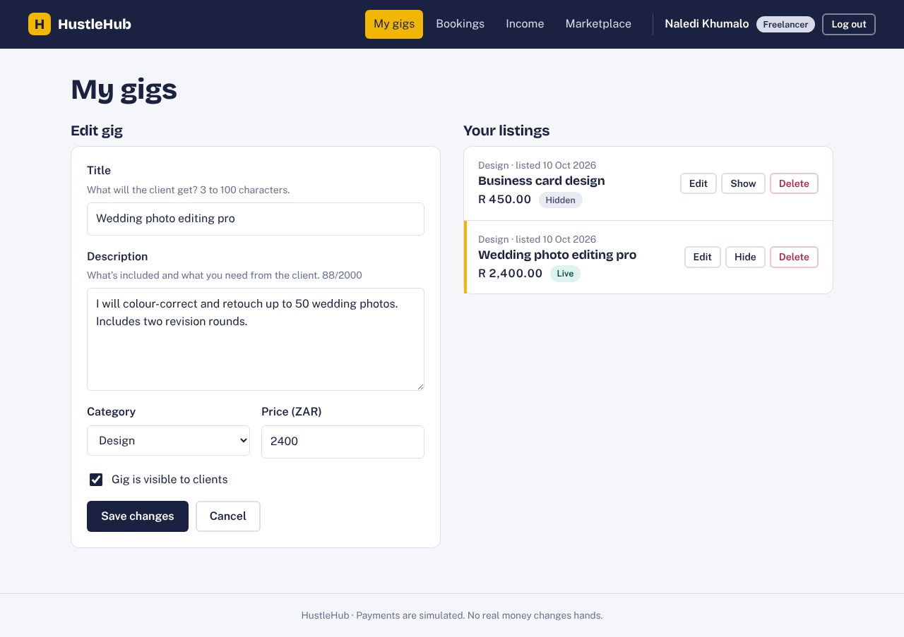 | Client: browse 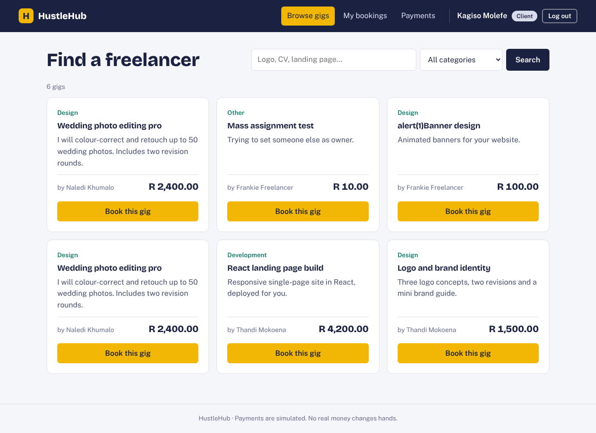 |
| Client: booking 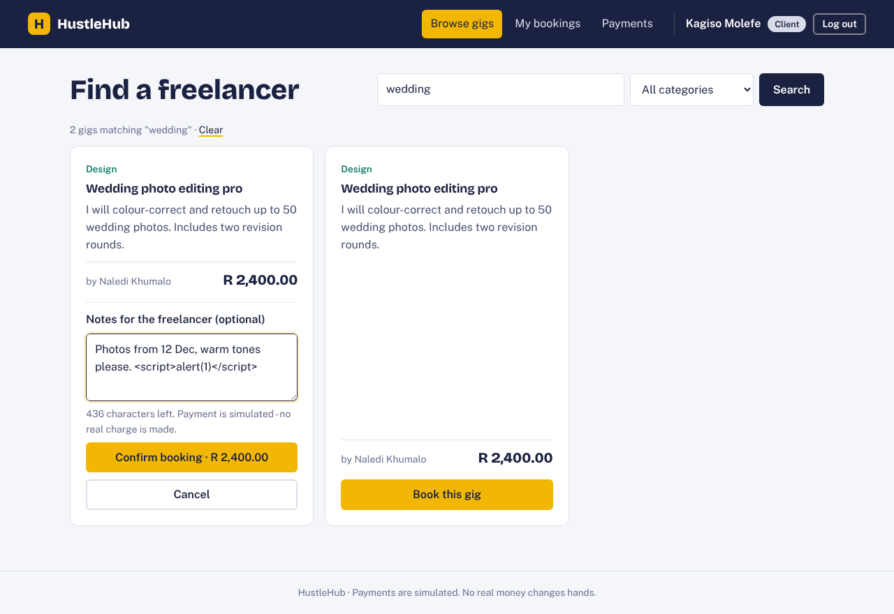 | Booking receipt + transaction 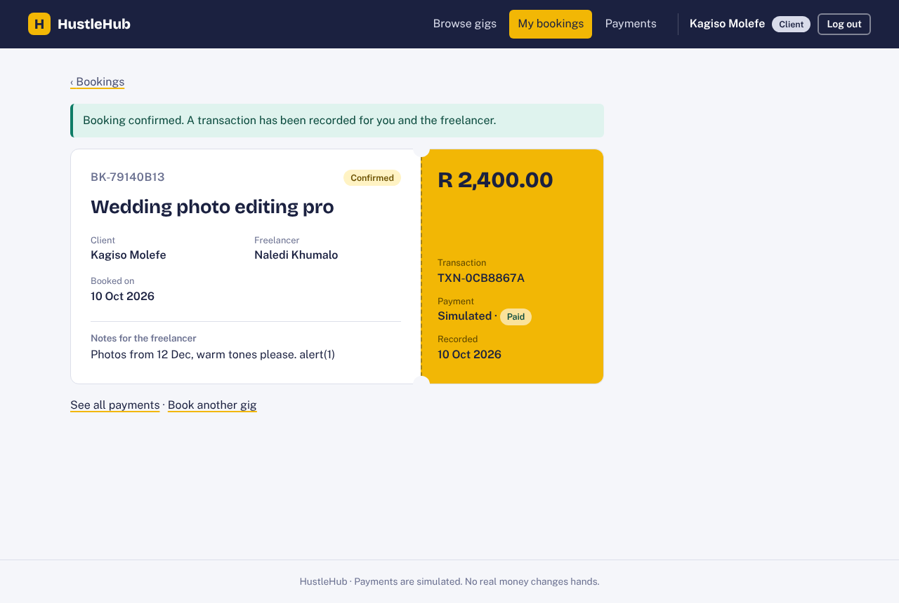 |
| Client: payments 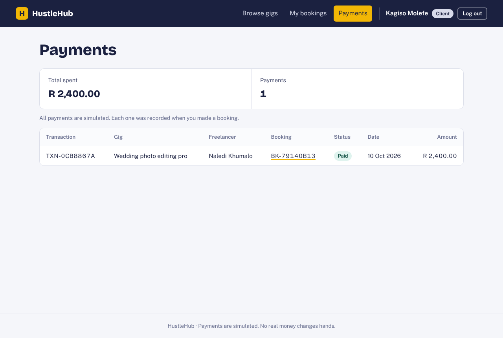 | Freelancer: bookings 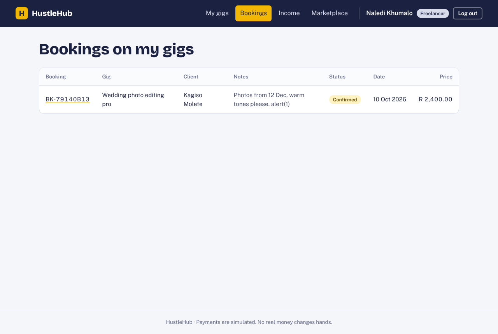 |
| Freelancer: income 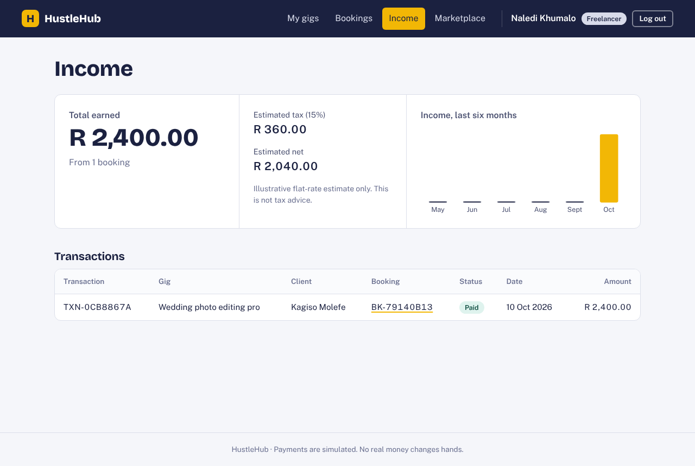 | Admin 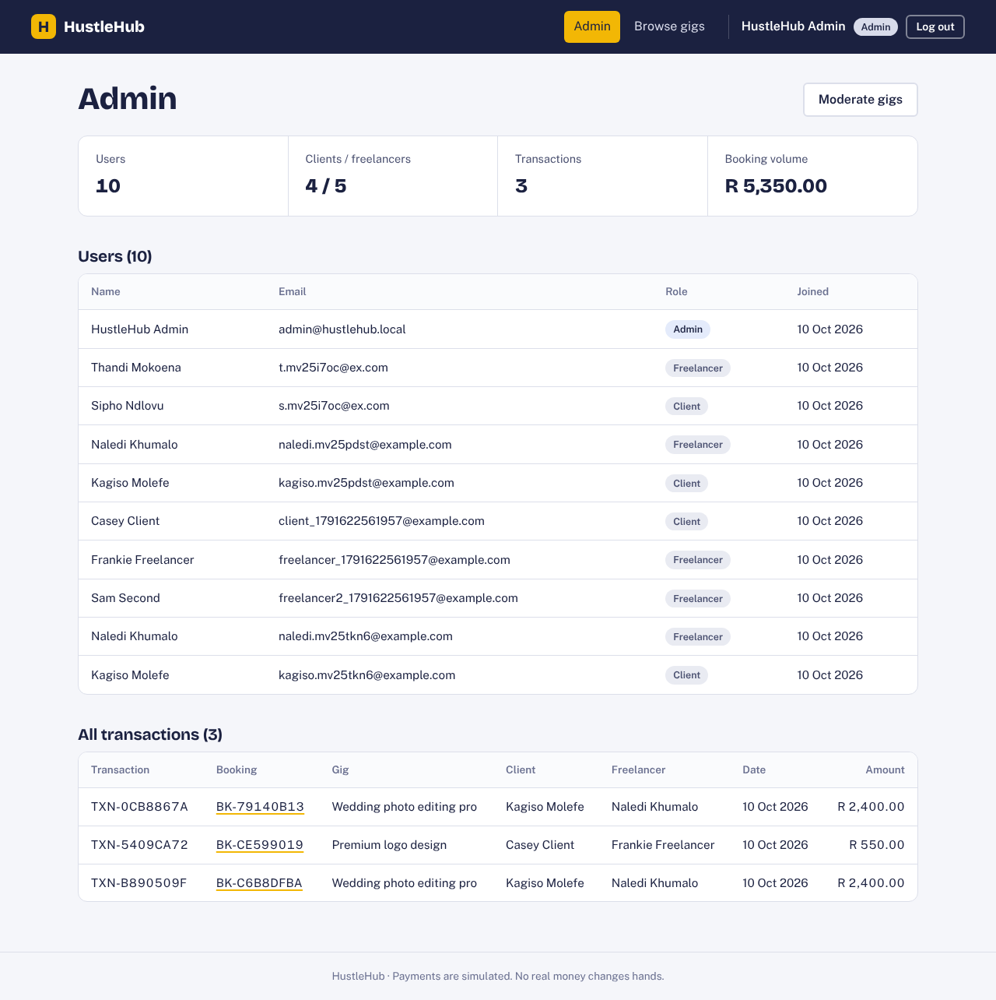 |
| Mobile receipt 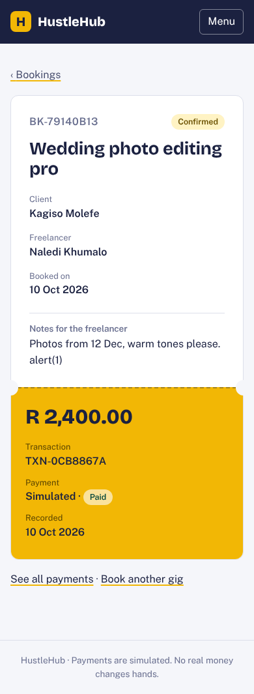 | |
